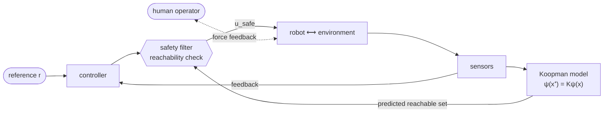

<p align="center">
  
</p>

<p align="center">
  <a href="https://scholar.google.com/citations?user=TnHXuQ4AAAAJ&hl=en"></a>
  <a href="https://www.linkedin.com/in/abdurrahman-aderinto/"></a>
  <a href="https://www.kfupm.edu.sa/"></a>
  
</p>

```console
$ ./aderinto --status
[ OK ] actuators ............ online
[ OK ] Koopman observables .. loaded
[ OK ] reachable set ........ certified ⊆ X_safe
[ OK ] 7+ yrs engineering ... hardware · embedded · production software
>>> ready. accepting collaborations.
```

I build robots that are safe by design, not only in a demo.

My research sits where **control theory**, **data-driven modeling**, and **formal safety guarantees** meet. The question that drives my work is simple to state and hard to answer: *when a robot touches the world, or a human guides it from a distance, how do we know it will behave?*

I bring 7+ years as an engineer, systems thinker, and problem solver to that question. I've worked across hardware, embedded systems, and production software. That background makes me care about the whole loop: sensing, modeling, control, verification, and the people who use the system.

## `01` Research focus

| Module | What I work on |
|---|---|
| 🦾 **Bilateral teleoperation for surface contact tasks** | Keeping force-feedback teleoperation stable and transparent while the remote robot is in sustained contact with a surface, so the operator feels what the robot feels without the loop going unstable. |
| 🧮 **Koopman operator reachability analysis** | Lifting nonlinear dynamics into linear Koopman representations to compute reachable sets and certify safety for systems where first-principles models fall short. |
| 🛡️ **Reliable autonomy** | Analysis and control methods that make autonomous systems predictable, verifiable, and graceful when things go wrong. |

The one-line version of the Koopman idea, for the curious:

$$
\psi(x_{k+1}) = \mathcal{K}\,\psi(x_k) \quad\Longrightarrow\quad \text{nonlinear dynamics, linear tools, certifiable reachable sets.}
$$

## `02` Schematic: how the pieces fit



## `03` Selected publications

1. O. O. Tooki, **A. A. Aderinto**, O. M. Popoola.
   *Development of an intelligent-based telemetry hexapod robotic system for surveillance of power system components.*
   **e-Prime: Advances in Electrical Engineering, Electronics and Energy**, vol. 10, 100806, 2024.

2. O. O. Tooki, **A. A. Aderinto**, I. A. Ojerinde, R. Abolade, D. Aborisade.
   *Development of an intelligence-based hexapod for surveillance using Raspberry Pi.*
   **IEEE International Conference on Science, Engineering and Business for Driving Sustainable Development Goals (SEB4SDG)**, 2024.

Full and up-to-date list on [Google Scholar](https://scholar.google.com/citations?user=TnHXuQ4AAAAJ&hl=en).

## `04` Path so far

```diff
+ 2025–now   PhD, KFUPM ............ reliable autonomy & robotics
+ research   hexapod robots ......... six-legged platform, onboard AI vision, telemetry
+                                     for surveillance of power-system infrastructure
+ industry   Encentral Solutions .... full-stack product work: TypeScript, Angular, Next.js
```

## `05` Lab bench

<p>
  
</p>

<p>
  
  
  
  
  
</p>

<details>
<summary><b>🔧 Lab rules</b> <i>(click to expand)</i></summary>
<br/>

1. If it isn't verified, it's a demo.
2. Everything is a feedback loop if you squint hard enough.
3. Model what you can, bound what you can't.
4. The best safety system is the one the operator never notices.
5. Always check the units. Then check them again.

</details>

## `06` Code

Most of my research code is kept private while the work is under review. If you're a researcher or student interested in a specific project, reach out and I'm happy to share.

## `07` Contribution telemetry

<picture>
  <source media="(prefers-color-scheme: dark)" srcset="https://raw.githubusercontent.com/abdurrahman-aderinto/abdurrahman-aderinto/output/snake-dark.svg"/>
  <source media="(prefers-color-scheme: light)" srcset="https://raw.githubusercontent.com/abdurrahman-aderinto/abdurrahman-aderinto/output/snake-light.svg"/>
  
</picture>

## `08` Get in touch

I'm always glad to talk with students, researchers, and teams working on robotics, control, and safe autonomy. The best way to reach me is on [LinkedIn](https://www.linkedin.com/in/abdurrahman-aderinto/).

<p align="center">
  
</p>
